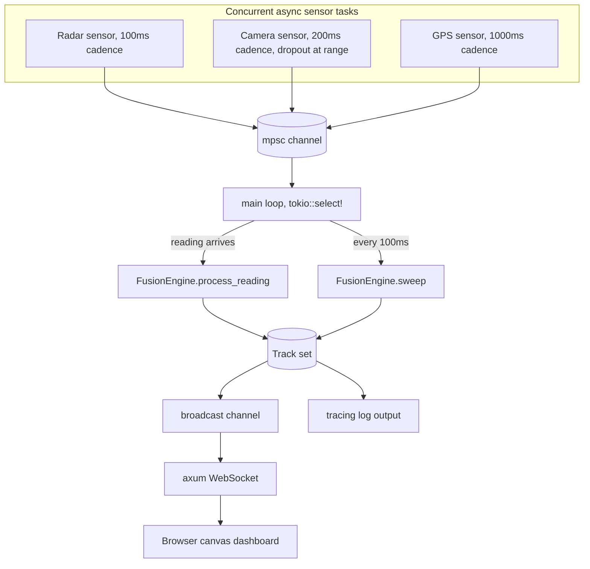
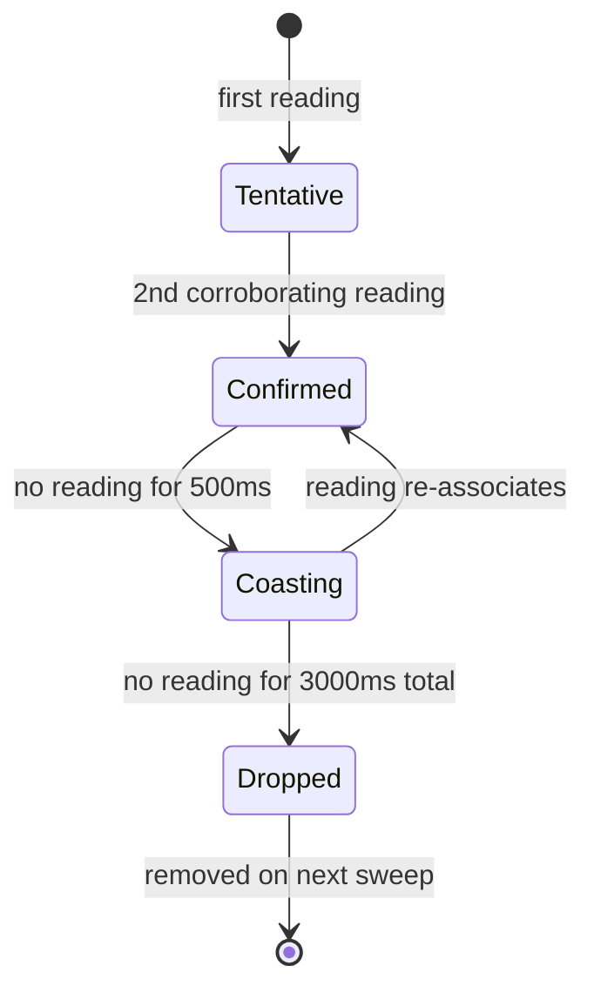

# Sentinel

A real time multi sensor fusion and tracking engine, built in Rust as a portfolio project focused on concurrency, real time constraints, and graceful degradation under sensor failure.

Three simulated sensor types (radar, camera, GPS) independently observe the same set of moving objects, each with different noise and dropout characteristics. A fusion engine consumes their noisy, asynchronous readings and reconstructs a single, coherent set of tracked objects in real time, streamed live to a browser dashboard over WebSocket.

## Why this project

The core problem here, associating noisy readings from multiple independent sensors into one trustworthy picture of the world and keeping that picture stable when a sensor drops out, is the same problem behind systems like shipboard air defense radar, autonomous vehicle perception stacks, and modern software defined sensor fusion platforms (Anduril's Lattice being a well known example). This project is a deliberately small, fully understood version of that problem. It is a simulation with fabricated ground truth, not a production sensor fusion system. Real radar returns, GPS drift, electromagnetic interference, and safety certification requirements add enormous complexity this project does not touch. The goal was to deeply understand the core algorithmic problem multi target trackers solve, not to build a defense system.

## Architecture



Three sensors run as independent async tasks, each observing the same ground truth objects and reporting through a shared channel. The main loop uses `tokio::select!` to handle two things concurrently: new readings arriving on the channel, and a 100ms timer tick that advances track lifecycle state. Lifecycle transitions have to run on a timer rather than being driven by readings, because a track with no sensor coverage still needs to age out even while nothing is arriving.

Every 100ms, the current set of tracks is broadcast to any connected dashboard clients over a `tokio::sync::broadcast` channel, which an axum WebSocket server forwards to a browser canvas that draws each track as a colored dot with a trail.

## Track lifecycle



A track starts as **Tentative** on its first reading. A second corroborating reading within the gating distance promotes it to **Confirmed**. If 500ms pass with no fresh reading, the track becomes **Coasting**, extrapolating its position from last known velocity instead of freezing in place. If silence continues past 3000ms total, the track is marked **Dropped** and physically removed on the following sweep, giving a consumer one cycle to observe the drop before the track disappears. A reading landing on a Coasting track snaps it straight back to Confirmed, since it was already corroborated before losing contact.

## Design decisions worth calling out

**Association is nearest neighbor with gating, not a Kalman filter.** Each incoming reading is matched to the closest existing track within a fixed gating distance (40 units, widened to 80 for Coasting tracks), or spawns a new track if nothing is close enough. Position updates use a confidence weighted average rather than a full Kalman filter. This is the simpler of the two approaches the original plan allowed for, and it captures the core association problem without the added complexity of covariance matrices.

**Velocity estimation has a minimum time delta guard.** Radar, camera, and GPS readings can land on the same track only milliseconds apart in wall clock time. Dividing position noise by a near zero time delta produced velocity spikes far beyond anything physically plausible during early testing (readings of 500+ units/sec on objects that top out around 70 units/sec). The fix ignores velocity updates when the time delta is below 30ms, and smooths velocity with more weight on the existing estimate (70/30) than the new sample, so no single noisy reading can dominate.

**Sensor confidence is clamped, not trusted as given.** A negative or NaN confidence value could corrupt the weighted average math downstream. Incoming confidence is clamped to [0.0, 1.0], with NaN treated as 0.0 rather than passed through, since `f64::clamp` leaves NaN unchanged by IEEE 754 semantics.

## Known limitations

**Track fragmentation on fast objects during Coasting gaps.** Association and lifecycle sweeps run on independent triggers (a reading arriving versus a 100ms timer). A reading can arrive while a track is still marked Confirmed, get checked against the tight gating distance instead of the wider Coasting gate, fail to associate, and spawn a duplicate track right as the original flips to Coasting a moment later. This was observed in practice on the fastest moving simulated object. It is a timing race between association and lifecycle state, not a distance miscalibration. Widening either gating constant reduces how often it happens but does not fix the underlying race, and trades against the opposite failure mode: false association between genuinely distinct objects. A real fix would compute the gate from elapsed time and the track's own velocity at read time, independent of cached status. Left as documented behavior rather than patched, since this is a standard, explainable limitation of multi target trackers, not a defect, and a fix would need its own test coverage before touching working association logic.

**No data validation beyond confidence clamping.** NaN and extreme position values are proven not to cause panics (see fault injection results below), but they do create orphaned "ghost" tracks that never associate with anything again, since NaN and infinite distances always fail gating comparisons. They do eventually get cleaned up by the normal Dropped timeout, since that logic is purely time based and does not depend on position validity.

## Benchmark: event driven vs naive polling

`src/bin/benchmark.rs` compares the channel consumption pattern main.rs actually uses (`rx.recv().await`, event driven) against a naive polling loop (`rx.try_recv()` on a fixed timer) at two poll intervals, under a synthetic load of 50,000 messages. Run with `cargo run --release --bin benchmark`.

| Approach | Throughput | Latency mean | Latency p99 | Empty polls |
|---|---|---|---|---|
| Event driven | 7,845,649 msg/sec | 4.0 us | 12 us | 0 |
| Naive polling, 500us interval | 1,011,289 msg/sec | 895.0 us | 2,388 us | 24 |
| Naive polling, 5ms interval | 350,032 msg/sec | 2,788.3 us | 7,148 us | 20 |

Event driven consumption wins decisively on both throughput and latency, which is expected. The more interesting finding is in the empty poll counts: only 20 to 24 out of 50,000 messages actually hit an empty channel. The producer kept the channel backlogged almost the entire time, so naive polling was not spending most of its time wastefully checking an empty queue. The real cost is that each of those rare misses costs the entire fixed sleep interval, even when the next message was already microseconds away. Twenty four misses at 500us and twenty misses at 5ms account for almost exactly the extra wall clock time each variant took over the event driven baseline. A fixed interval poll cannot distinguish "nothing is coming for a while" from "something is arriving right now," and that is where the real cost of naive polling comes from under sustained load, not from constant busy checking.

## Fault injection

Two things were tested: garbage input at the engine level, and killing a sensor live.

**Garbage input**, tested as unit tests in `fusion.rs` since a killed sensor and a sensor that simply stops sending readings look identical to `FusionEngine`, which only ever sees `SensorReading`s and never sensor tasks:

- NaN position: comparisons against NaN are always false in IEEE 754, so a NaN reading fails every gating check and spawns an isolated track rather than corrupting an existing one or panicking.
- Extreme position (1e300): squaring overflows f64 to infinity rather than panicking, since Rust floats saturate rather than panic on overflow. Infinite distance fails gating the same way NaN does.
- Negative or NaN confidence: clamped to [0.0, 1.0] before it can reach the weighting math.
- Total sensor outage: with no readings arriving at all, a confirmed track correctly progresses Confirmed to Coasting to Dropped to removed, purely from repeated `sweep()` calls advancing wall clock time.

All 13 unit tests pass, 8 from earlier lifecycle and association work plus 5 written specifically for this.

**Live sensor kill**, in `main.rs`: after 15 seconds of normal operation, the GPS sensor task is aborted outright while radar and camera keep running. Verified by log timestamps:

```
2026-08-06T00:01:30.705277Z  INFO sentinel: Fault injection armed: GPS sensor will be killed after 15s
2026-08-06T00:01:45.707141Z  WARN sentinel: FAULT INJECTED: GPS sensor task aborted; radar and camera continue
```

Exactly 15.0 seconds later, as designed. The dashboard continued running afterward with all three tracks still Confirmed and no visible disruption, since radar and camera alone are enough to keep every track corroborated.

## Running it

Requires Rust (tested against 1.97.1, installed via rustup).

```
cargo build
cargo run --bin sentinel
```

Open `http://127.0.0.1:3000` in a browser to see the live dashboard. GPS will be killed automatically 15 seconds after startup as a fault injection demonstration; the other two sensors continue and tracking is unaffected.

```
cargo test
```

Runs all 13 unit tests covering association, lifecycle transitions, and fault injection.

```
cargo run --release --bin benchmark
```

Runs the event driven vs naive polling comparison. Use `--release`, since debug builds are unoptimized and produce noisy, unrepresentative microsecond scale latency numbers.

## Project structure

```
src/
  main.rs        entry point, wires sensors, fusion engine, and dashboard together
  types.rs       shared data types (Position, SensorReading, Track, TrackStatus)
  world.rs       simulated ground truth objects moving in circular paths
  sensor.rs      three async sensor tasks with independent noise and dropout models
  fusion.rs      the fusion engine: association, gating, lifecycle, unit tests
  dashboard.rs   axum WebSocket server and inline HTML/JS canvas dashboard
  bin/
    benchmark.rs standalone event driven vs naive polling benchmark
```

## Demo

[Link to demo clip]

The clip shows: sensors starting up and tracks forming from Tentative to Confirmed, the live dashboard with tracks moving and leaving trails, and the terminal log showing the GPS sensor being killed at the 15 second mark with the dashboard continuing unaffected.
